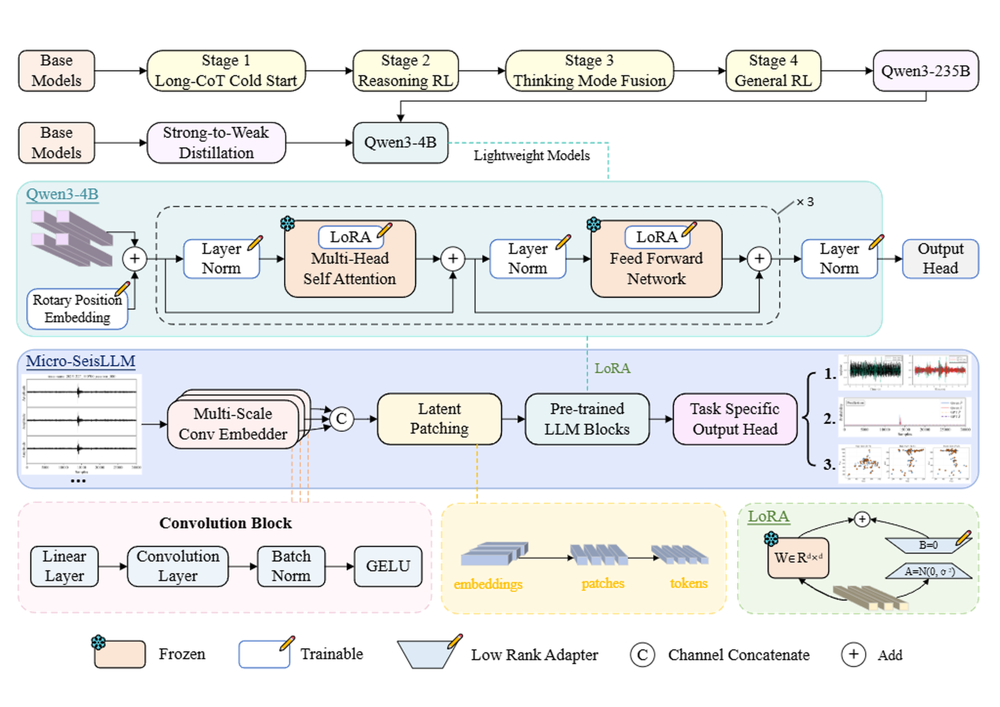

# Micro-SeisLLM

Code for **Micro-SeisLLM: LLM-based Microseismic Noise Suppression, Phase Picking, and Source Localization** (manuscript aimed at *Computers & Geosciences*).

Contact: `meli@xsyu.edu.cn`  
Repository: https://github.com/jmy403169-crypto/Micro-SeisLLM

The package wraps three monitoring tasks around the same waveform encoder idea: a multi-scale CNN embedder, latent patching into tokens, the first few layers of **Qwen3-4B** or **GPT-2** with **LoRA** (`r=16`), and a task head. Base LLM weights are not in this git tree; download them locally (see below).

## Architecture



**Overview of Micro-SeisLLM.** Multi-component waveforms are transformed by a multi-scale convolutional embedder and latent patching module. The resulting tokens are processed using a truncated language-model backbone with LoRA adaptation, followed by task-specific heads for noise suppression, first-arrival picking, and source localization.

## Three tasks

| Task | Model factory | Typical input |
|------|---------------|---------------|
| Noise suppression | `SeisMoLLM_denoise_event` | Multi-station `(N, T, 3)` noisy / clean pairs |
| First-arrival picking | `SeisMoLLM_dpk` | Three-component window `(3, T)` |
| Source localization | `SeisMoLLM_loc_event` | Multi-station event + station context; denormalize with `loc_norm_stats.json` |

## Repository layout

```text
Micro-SeisLLM/
├── src/microseisllm/   # models, datasets, losses, metrics, utils
├── configs/            # denoising | phase_picking | source_localization × {qwen3,gpt2}.yaml
├── scripts/            # train / evaluate / inference / reproduce / download_backbones
├── examples/           # short CPU/GPU smoke demos on data/sample
├── data/sample/        # synthetic mini-sets only
├── data/splits/        # sample + full-corpus split metadata
├── checkpoints/        # download notes; empty adapter dirs with README placeholders
├── results/            # expected_metrics.json + per-task output dirs + sample_outputs/
├── tests/              # pytest smoke tests (no LLM download)
├── docs/               # data format, training, evaluation, reproducibility
├── pyproject.toml      # canonical package metadata (name microseisllm, 0.1.0)
├── environment.yml
├── requirements.txt
├── LICENSE             # Apache-2.0 for code
├── LICENSE_NOTES.md    # code vs data vs weight scope
└── THIRD_PARTY_NOTICES.md
```

## Environment

| Item | Version |
|------|---------|
| Python | 3.9+ (conda env pinned to **3.10**) |
| PyTorch | 2.4.0 in `requirements.txt` (2.1+ accepted by the package) |
| CUDA | Match your PyTorch build; paper runs used a CUDA GPU with ≥16 GB VRAM for Qwen3-4B fine-tuning |
| Disk | ~10 GB for GPT-2 experiments; ~20+ GB if you keep Qwen3-4B locally |

Hardware for the paper tables: single NVIDIA GPU, 24 GB class recommended for Qwen3; GPT-2 task runs fit in less memory.

## Install

```bash
git clone https://github.com/jmy403169-crypto/Micro-SeisLLM.git
cd Micro-SeisLLM

# Conda
conda env create -f environment.yml
conda activate microseisllm
pip install -e .

# Or pip-only
python -m venv .venv
# Windows: .venv\Scripts\activate
pip install -r requirements.txt
pip install -e .
```

Editable install reads `pyproject.toml`. `setup.py` is only a setuptools shim; do not diverge package name / version from `pyproject.toml`.

## Quick verification

```bash
conda env create -f environment.yml
conda activate microseisllm
pip install -e .

pytest tests -q

python examples/quickstart_denoising.py
python examples/quickstart_picking.py
python examples/quickstart_localization.py
```

Rough wall-clock on a mid-range laptop (CPU, sample data only):

| Command | Typical time |
|---------|--------------|
| `pytest tests -q` | 1–3 min |
| each `examples/quickstart_*.py` | 30–90 s |

Paper-table evaluation with full checkpoints and GPU: tens of minutes per task, depending on test-set size.

Under normal completion the quickstarts / inference helpers write under `results/sample_outputs/`:

- `denoised.npz` — denoised waveform dump  
- `picks.json` — P/S arrivals  
- `location.json` — source coordinates  

(Metrics JSON files from evaluate scripts may appear alongside.)

## Input / output formats

See `docs/data_format.md`. Short version:

- Waveforms: NPZ, last axis = E/N/Z, **500 Hz**, window **4000** samples (8 s) for the bundled set.  
- Picking labels: P/S as **sample indices**.  
- Localization: `events/*.npz` + `stations.csv` + `catalogue.csv` + `velocity_model.json`.  
- Metrics / predictions: JSON under `results/...`.

## Synthetic vs field data

`data/sample/` is a **tiny synthetic** subset for install and CI. The paper also reports **full synthetic** test metrics and **field** microseismic results. Field waveforms are not redistributed. Full synthetic split sizes and seed are recorded in `data/splits/full_synthetic_split_meta.json` (905 / 100 / 1005 events family, `seed=0`). Sample splits in `data/splits/*_split.json` are for demos only.

## Random seeds and splits

Each YAML sets `random_seed`. Split JSON files store `train_event_ids` / `validation_event_ids` / `test_event_ids` and the seed used to draw them. Keep the same seed and split file when comparing to `results/expected_metrics.json`.

## Download base models and task weights

```bash
python scripts/download_backbones.py --backbone all
```

Or point `MICROSEISLLM_QWEN3_PATH` / `MICROSEISLLM_GPT2_PATH` (and YAML `llm_path`) at existing folders.

Task checkpoints (truncated LLM + LoRA + heads) are **not** in git. When published, URLs, sizes, and SHA256 go in `checkpoints/README.md`; place files under `checkpoints/lora_adapters/<task>/`.

## Reproduce paper tables

Numbers and allowed error bars: `results/expected_metrics.json`.  
Command ↔ config ↔ output map: `docs/reproducibility.md`.

```bash
python scripts/evaluate_denoising.py --config configs/denoising/qwen3.yaml --checkpoint checkpoints/lora_adapters/denoising/best.pt
python scripts/evaluate_phase_picking.py --config configs/phase_picking/qwen3.yaml --checkpoint checkpoints/lora_adapters/phase_picking/best.pt
python scripts/evaluate_source_localization.py --config configs/source_localization/qwen3.yaml --checkpoint checkpoints/lora_adapters/source_localization/best.pt
```

Swap `gpt2.yaml` for the GPT-2 column. Unified helper: `python scripts/reproduce_results.py`.

Reference synthetic metrics (Qwen3 / GPT-2):

| Task | Metric | Qwen3 | GPT-2 |
|------|--------|-------|-------|
| Denoising | ΔSNR (dB) / CC | 28.12 / 0.935 | 28.29 / 0.939 |
| Picking | P-MAE (ms) / P-F1 | 135.8 / 0.971 | 143.4 / 0.966 |
| Localization | loc4 MAE (m) | 25.77 | 14.73 |

Tolerances are listed in `expected_metrics.json`. Matching these requires the released weights and the full test set, not `data/sample/`.

## License

- **Code:** Apache-2.0 (`LICENSE`)  
- **Scope of data / weights:** `LICENSE_NOTES.md`  
- **Third-party models & libraries:** `THIRD_PARTY_NOTICES.md`  
- Apache legal NOTICE file: `NOTICE` (do not dump the whole dependency list there)

## Citation

```bibtex
@misc{yang2026microseisllm,
  title        = {Micro-SeisLLM: LLM-based Microseismic Noise Suppression, Phase Picking, and Source Localization},
  author       = {Yang, Jiamin and Li, Meng and Wang, Hua and Fang, Zhilong and Chen, Kun},
  year         = {2026},
  howpublished = {GitHub repository},
  url          = {https://github.com/jmy403169-crypto/Micro-SeisLLM},
  note         = {Software repository accompanying a manuscript prepared for Computers \& Geosciences}
}
```

Also see `CITATION.cff`.

## Limitations

- Field data used in the manuscript cannot be shared; outsiders can only reproduce the synthetic track and the code path.  
- Saved experimental `.pth` files embed truncated base-LLM slices plus LoRA and heads; they are large and stay off GitHub.  
- Sample quickstarts use random or incomplete weights unless you supply a checkpoint — they prove wiring, not paper numbers.  
- Qwen3 and GPT-2 remain under their upstream licenses after download.

## Status before public “camera-ready” release

Directory layout and docs are in place. Before calling the repo final for journal upload, finish: hosting of task weights (URL / size / SHA256), a clean-environment install + test pass on the machine that submits the paper, and any author-name updates required by the journal.
